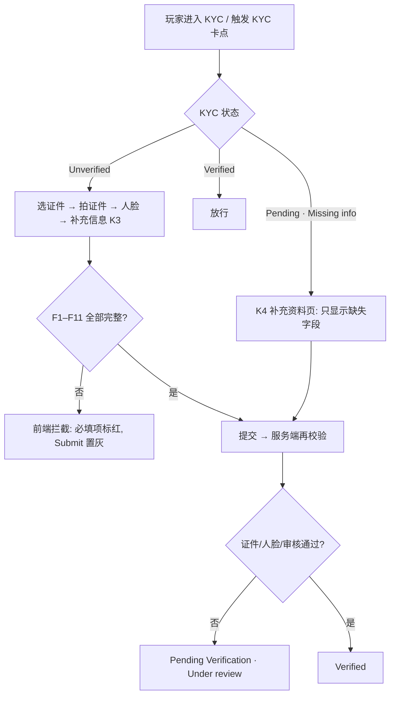

# 【789games / 789bingo】KYC 验证状态与后台 Gaming Venue 字段调整 PRD v1.0

2026-11-27 · Koi

> 来源：合规文件第 7 节「KYC Verification and Back-Office Gaming Venue Requirements」（Koi 2026-11-27 提供的截图）。本 PRD 只处理该节提出的 3 点要求，不改 KYC 证件 / 人脸流程本身。
> 参考范例：Home 页轮播弹窗 PRD v1.0（改造现网后台模块 + 前台展示，取 As-Is 问题表、状态计算表、旧数据迁移、风险表）。

## 资料

| 资料 | 链接 |
|---|---|
| 可交互原型 | [kyc-gaming-venue-prototype-v1.0.html](../kyc-gaming-venue-prototype-v1.0.html)（下载后浏览器打开） |
| 需求原文 | 合规文件第 7 节截图（见本文 §1.1 原文摘录） |
| 关联 Jira | -6448 / -6450 新版 KYC「KYC 提交信息配置」+ 10 站点选择（产品验收中）；-5603 场馆代码按已审批 Venue 清单统一；GAM-2 789games 继承老站 KYC |
| Jira（本需求） | 待建：故事单 + 后端 / 后台前端 / H5 / iOS / Android |
| Wiki | 待建：PD › 2026-11 › KYC 验证状态与 Gaming Venue |

---

## 1. 背景与范围

### 1.1 需求原文（摘录）

1. A player may be marked **Verified** only after they have provided all required KYC information. If any required information is missing, the player must remain **Pending Verification**.
   玩家提交全部必填 KYC 资料后，方可标记为已验证（Verified）；任何必填资料缺失，状态须保持待验证（Pending Verification）。
2. The gaming venue displayed in the back office must match the venue the player selected during KYC registration. The field label in the back office must be displayed in English as **Gaming Venue**.
   后台显示的游戏场所必须与玩家 KYC 时选择的场所一致；后台字段标签须以英文 **Gaming Venue** 显示。
3. Complete information is required in all fields. 所有字段均为必填项，且所填信息须完整。
   截图标注：后台「投注站」标签 → This should be translated into English.

### 1.2 现状（As-Is）

依据：合规文件中的后台截图（会员详情 › Basic Information）。截图含真实玩家资料，本文和原型中的姓名、账号、地址均已替换为示例值。**本 PRD 未登录 QA 后台核对，下列现状以截图为准，开发前需在 QA 后台复核（见待确认 Q1）。**

| 字段（截图顺序） | 截图中的值 | 说明 |
|---|---|---|
| Username | Player_demo01 **Verified** | 状态标签显示 Verified |
| Full Name | （灰字，已填） | |
| First Name / Middle Name / Last Name | JUAN / SANTOS / 已填 | Middle Name 旁有「Don't have」选项 |
| Nationality / Birthday / Place of Birth | PHILIPPINES / 已填 / 已填 | |
| Nature of Work | **Select（空）** | 截图红框标出：未填写 |
| Source of Income | Others（另有 Others 补充框） | |
| **投注站** | LAGUNA | 标签是中文，截图箭头标出：须改英文 |
| Current Home Address | **Select（空）**，旁边有地址文本 | 省市下拉未选 |
| Permanent Home Address | Select + 地址文本 | 有「Use Current Address」 |

| # | 问题 | 影响 |
|---|---|---|
| P1 | 必填资料（Nature of Work、Current Home Address）缺失，账号仍显示 Verified | 合规不通过；缺资料用户享受 Verified 权益（提款等） |
| P2 | 后台标签「投注站」为中文 | 不符合合规要求，审计方看不懂 |
| P3 | 「投注站」的值取自哪里不明确：可能是玩家 KYC 选择的场所（-6450），也可能是「用户 → 代理 → 投注站」归属关系 | 若取的是归属关系，会与玩家 KYC 选择的场所不一致，不符合第 2 条 |
| P4 | 现网有「KYC 提交信息配置」，每个字段可单独设为非必填；另有「部分认证用户可提款」开关 | 与「所有字段必填」冲突，运营可能把合规字段改成非必填 |

### 1.3 包含 / 不包含

| 包含 | 不包含 |
|---|---|
| KYC 状态判定：必填资料完整才可 Verified，否则 Pending Verification | 证件扫描、人脸比对、供应商（zoloz / Paddle）逻辑 |
| 后台会员详情 Basic Information：标签改英文，新增 Gaming Venue 取值规则，缺失字段高亮 | 投注站归属规则（用户 → 代理 → 投注站）本身 |
| 「KYC 提交信息配置」中合规字段锁定为显示 + 必填 | 新增 KYC 字段 |
| 玩家端：缺资料时提示补充，只补缺失字段，不重做证件和人脸 | KYC 审核列表的审核流程改造 |
| 存量 Verified 用户资料完整性检查与迁移 | PAGCOR 报表口径 |

### 1.4 目标

- 合规：任何时刻不存在「必填资料缺失但状态为 Verified」的账号（上线后抽查 0 例）。
- 后台 Gaming Venue 与玩家 KYC 选择 100% 一致（按 KYC 记录取值，不经第二个来源）。
- 存量缺资料用户只需补缺失字段，补完 ≤ 1 分钟。

### 1.5 适用范围

- 站点：789games + 789bingo。两站共用后端和 KYC 库（GAM-2），规则同时生效（Q2 确认）。
- 端：H5 / iOS / Android / 后台。语言：玩家端 English；后台本区块全部英文。时间：GMT+8。

---

## 2. 规则

### 2.1 必填字段清单（合规字段）

| # | 字段 | 完整的判定 | 备注 |
|---|---|---|---|
| F1 | First Name | 非空，去首尾空格后 ≥ 1 字符 | |
| F2 | Middle Name | 非空 **或** 勾选「Don't have」 | 勾选 Don't have 视为完整 |
| F3 | Last Name | 非空 | |
| F4 | Nationality | 已选 | |
| F5 | Birthday | 已填，且满 21 岁 | 沿用现网 21+ 校验 |
| F6 | Place of Birth | 非空 | |
| F7 | Nature of Work | 已选（下拉） | 截图中缺失 |
| F8 | Source of Income | 已选；选 Others 时补充说明非空 | |
| F9 | **Gaming Venue** | 已选，且是已审批 Venue 清单中启用的场所 | -6450 的 10 站点选择；清单按 -5603 |
| F10 | Current Home Address | 省 / 市（下拉）已选 **且** 详细地址非空 | 截图中下拉未选 |
| F11 | Permanent Home Address | 省 / 市已选且详细地址非空，或勾选「Same as Current Address」 | |
| — | 证件、人脸 | 沿用现网：证件扫描通过 + 人脸比对通过 | 不在本次改动范围，但参与状态判定 |

Full Name 由 F1–F3 拼接，不单独判定。

### 2.2 状态判定（服务端计算，前端 / 后台只展示）

| 状态（英文原文） | 条件 | 玩家端 Account 页 | 后台 |
|---|---|---|---|
| Unverified | 未提交过 KYC | Unverified + Verify Now | Unverified（灰） |
| **Pending Verification** | 已提交，但满足任一：① F1–F11 有缺失；② 证件 / 人脸 / 人工审核未完成 | Pending Verification + 原因（见 §3） | Pending Verification（橙）+ 子原因：Missing info / Under review |
| Verified | F1–F11 全部完整 **且** 证件、人脸、审核全部通过 | Verified | Verified（绿） |
| Rejected | 审核驳回（沿用现网） | E-KYC Rejected（沿用） | Rejected（红） |

- **判定时点**：玩家提交 / 补充资料、审核通过、后台改资料、存量迁移脚本运行时都重新计算。任何路径（含人工审核「通过」按钮）都不能把缺资料的账号置为 Verified：审核通过时若资料不完整，状态落到 Pending Verification（Missing info），并提示审核员缺哪几项。
- **Fully Verified**：现网玩家端有 Verified / Fully Verified 两档。本次以合规口径统一为 Verified（= 原 Fully Verified）；原「Verified（部分认证）」归入 Pending Verification（Q3 确认）。
- **Pending Verification 的权益**：按「未完成 KYC」处理，所有 KYC 卡点照常拦截（提款、绑卡、强制 KYC 游戏、红包、转盘阈值）。「部分认证用户可提款」开关对 Missing info 不生效（Q4 确认）。

### 2.3 Gaming Venue 取值

- **唯一来源**：玩家 KYC 时选择的场所（KYC 记录中的 venue 字段，-6450）。后台、导出、审核列表都读这个字段。
- **不读**「用户 → 代理 → 投注站」归属关系。两者不一致时不自动改写任何一方；归属关系仍用于代理 / 报表统计（不在本次范围）。
- 名称按已审批 Venue 清单（-5603）显示英文名，如 LAGUNA。
- 老 KYC 记录（-6450 上线前完成、没有 venue）：Gaming Venue 视为缺失 → Pending Verification（Missing info），玩家补选后恢复。
- 后台只读，不提供编辑（Q5 确认是否需要客服代改）。

### 2.4 「KYC 提交信息配置」调整

- F1–F11 在配置页锁定为「显示 = 是、必填 = 是」，开关置灰并提示：Required by compliance (PAGCOR). Cannot be changed.
- 其余非合规字段（如有）保持可配。
- 服务端提交接口以服务端字段清单校验，不依赖前端配置（防止老包 / 配置被改后漏传）。

---

## 3. 前台流程

| 编号 / 页面 | 触发条件 | 页面表现 |
|---|---|---|
| K3 补充信息（Personal Information） | KYC 流程第 3 步 | F1–F11 全部带红色 *；任一未填则 Submit 置灰；点 Submit 时未填项标红并滚动到第一个；Gaming Venue 为下拉，列出启用的场所 |
| K4 补充资料（Complete Your Information） | 状态 = Pending Verification · Missing info，从 Account 页 / KYC 卡点弹窗进入 | 顶部说明 + 只列缺失字段（已填字段只读折叠展示）；提交后不重做证件和人脸 |
| A1 Account 页 KYC 状态 | 常驻 | Pending Verification 显示橙色标签 + 一行原因：Missing info → "Please complete your information"（按钮 Complete Now → K4）；Under review → "Your verification is under review" |
| P1 KYC 卡点弹窗 | 现网卡点（提款、绑卡、游戏等） | Missing info 时文案改为 "Please complete your KYC information to continue."，按钮 Complete Now → K4；其他沿用现网 |

文案（英文原文）：

| 场景 | 文案 |
|---|---|
| 必填未填 | This field is required |
| Gaming Venue 下拉占位 | Select your gaming venue |
| K4 标题 / 说明 | Complete Your Information / Some required information is missing. Please complete the fields below to finish verification. |
| K4 提交成功 | Information submitted. Your verification status will be updated shortly. |
| 选的场所已停用（提交时） | This venue is no longer available. Please select another one. |

弹窗：P1 沿用现网 KYC 卡点弹窗位置，不新增登录弹窗，不进 Home 队列。

---

## 5. 后台配置

### 5.1 会员详情 › Basic Information

菜单：用户管理 › 会员列表 › 会员详情（以 QA 后台实际路径为准）。

| 改动 | 现网 | 调整后 |
|---|---|---|
| 标签语言 | 「投注站」中文 | **Gaming Venue**；本区块所有标签英文（后台切到简体中文时本区块也保持英文） |
| Gaming Venue 取值 | 来源不明（P3） | KYC 记录 venue 字段，按 §2.3 |
| 状态标签 | Verified（与资料是否完整无关） | 按 §2.2 显示 4 种状态；Pending 时附子原因 |
| 缺失字段 | 只显示 Select / 空白 | 缺失字段红框 + 字段下方红字 "Missing"；区块顶部提示条：KYC information incomplete: Nature of Work, Current Home Address |
| Middle Name「Don't have」 | 复选框 | 只读展示；勾选时值显示 "N/A (Don't have)" |

区块字段顺序沿用截图，Gaming Venue 保持原位置（Source of Income 下方）。

### 5.2 KYC 审核

- 审核「通过」前校验 F1–F11；有缺失时按钮旁提示缺失项，点通过后状态为 Pending Verification（Missing info），不是 Verified。
- 审核列表新增筛选「Missing info」（是 / 否），新增列 Gaming Venue。

### 5.3 KYC 提交信息配置

按 §2.4 锁定 F1–F11。

### 5.4 存量迁移

1. 上线前跑只读检查脚本：统计两站当前 Verified 且 F1–F11 有缺失的账号数，按缺失字段分组，结果给 Koi 和合规（Q6 决定是否降级）。
2. 确认后执行：这些账号改为 Pending Verification（Missing info），写操作日志（操作人 = system，原因 = Compliance §7 migration）。
3. 降级后玩家下次进入 / 触发卡点时引导到 K4；已在途的提款单不受影响（Q7）。

---

## 6. 权限

| 权限码 | 名称 | 说明 |
|---|---|---|
| 沿用 | 会员详情查看 | 不新增；Gaming Venue 只读 |
| 新增（cate=3，号段开发分配） | 导出 KYC 资料完整性报表 | 迁移检查结果导出；服务端校验，授权后重新登录生效 |

---

## 7. 日志与埋点

- 操作日志：KYC 状态每次变化记录 旧状态 → 新状态、触发来源（player_submit / review / migration / admin_edit）、缺失字段列表。敏感字段（地址、生日）不写明文值。
- 埋点：沿用 firebase-tracking-spec `kyc_step`、`kyc_result`；`kyc_result.result` 增加 `pending_missing_info`；新增 `kyc_complete_info_view`（K4 曝光）。不上报任何字段值（PII）。上报通道待确认。

---

## 8. 接口

| 方法 | 路径（草案） | 说明 |
|---|---|---|
| GET | /api/kyc/status | 返回 status、subReason（missing_info / under_review）、missingFields[] |
| GET | /api/kyc/venues | 启用的 Gaming Venue 列表（id、英文名） |
| POST | /api/kyc/submit | 首次提交；服务端校验 F1–F11，缺失返回字段级错误码 |
| POST | /api/kyc/complete | K4 补充缺失字段；只接受 missingFields 内的字段；requestId 幂等 |
| GET | /api/admin/member/{id}/kyc-basic | 后台 Basic Information；gamingVenue 取 KYC 记录 |
| POST | /api/admin/kyc/migration/check | 存量完整性检查（只读，异步导出） |

状态计算统一封装为一个服务端方法，所有写入 KYC 状态的入口调用它，禁止直接写 Verified。

---

## 10. 验收要点

1. F1–F11 任一为空提交：H5 / iOS / Android 前端拦截；绕过前端直调接口也返回错误，状态不变。
2. Middle Name 勾选 Don't have、Permanent Address 勾选 Same as Current：视为完整，可 Verified。
3. Source of Income 选 Others 不填说明：不完整。
4. 证件 / 人脸通过但缺 Nature of Work：状态 Pending Verification · Missing info；补填后 → Verified（或 Under review）。
5. 审核员对缺资料账号点「通过」：结果 Pending Verification，有缺失提示。
6. 后台 Basic Information：标签显示 Gaming Venue（中文界面下也是英文）；值与玩家 KYC 所选一致；把该用户转移到另一投注站后 Gaming Venue 不变。
7. 老 KYC 无 venue：后台 Gaming Venue 显示 Missing，状态 Pending；玩家 K4 只需选 Venue。
8. 场所停用后：已选的玩家后台仍显示原名；新提交时该场所不在下拉中。
9. 配置页 F1–F11 开关不可改；直接调配置接口改为非必填，服务端拒绝。
10. Pending Verification 用户：提款、绑卡、游戏强制 KYC 卡点照常拦截，弹窗引导 K4。
11. 迁移：检查脚本数字与抽查一致；降级后日志完整；在途提款单状态不变。
12. 两站分别验证；789games 继承老站 KYC 的用户同样按规则判定。

---

## 11. 待确认

| # | 问题 | 当前默认处理 | 找谁 |
|---|---|---|---|
| Q1 | 现网「投注站」值取自 KYC 选择还是归属关系？Nature of Work、地址下拉为何可空？ | 开发前在 QA 后台和库里复核，结果补进 §1.2 | 后端 |
| Q2 | 两站是否同时生效 | 同时生效（共用 KYC 库） | 合规 / Koi |
| Q3 | 现网 Verified / Fully Verified 两档如何映射 | Fully Verified → Verified；部分认证 → Pending Verification | 合规 / Koi |
| Q4 | 「部分认证用户可提款」开关是否保留 | 对 Missing info 不生效；开关本身是否下线另议 | 合规 / 风控 |
| Q5 | 客服是否需要代改 Gaming Venue | 不提供，只能玩家自己补选 | 客服 / 合规 |
| Q6 | 存量缺资料 Verified 用户是否直接降级 | 先出统计，确认后降级 | 合规 / 运营 |
| Q7 | 降级时在途提款单怎么处理 | 不拦截在途单，之后的新单按新状态 | 风控 / 财务 |
| Q8 | Nature of Work、Source of Income 下拉选项是否需按合规清单调整 | 沿用现网选项 | 合规 |
| Q9 | 埋点上报通道 | 待定（平台无服务端埋点通道） | 数据 |

---

## 12. 风险与依赖

| 等级 | 类别 | 风险 | 应对 |
|---|---|---|---|
| 高 | 合规 | 存量缺资料 Verified 账号继续存在 | §5.4 迁移；上线后抽查 |
| 高 | 资金 | 大批量降级后提款被拦，客诉 / 流失 | 先统计规模；K4 只补缺失字段；客服话术提前准备 |
| 中 | 多端一致性 | 老包仍按旧配置漏传字段（参考 -2123 必填留空也能提交） | 服务端校验为准；老包提交缺字段时返回错误并提示升级 / 走 H5 |
| 中 | 稳定性 | 多个入口直接写状态，漏改导致仍出现 Verified | 统一状态计算方法 + 验收第 5 条 |
| 低 | 安全 | 日志写入地址等敏感明文 | 日志只记字段名 |

依赖：-6448 / -6450 验收完成（venue 字段落库）；已审批 Venue 清单（-5603）；各端 KYC 页改版排期。

---

## 13. 变更记录

| 日期 | 变更 |
|---|---|
| 2026-11-27 | v1.0 初稿：按合规文件第 7 节整理，含原型 v1.0 |
