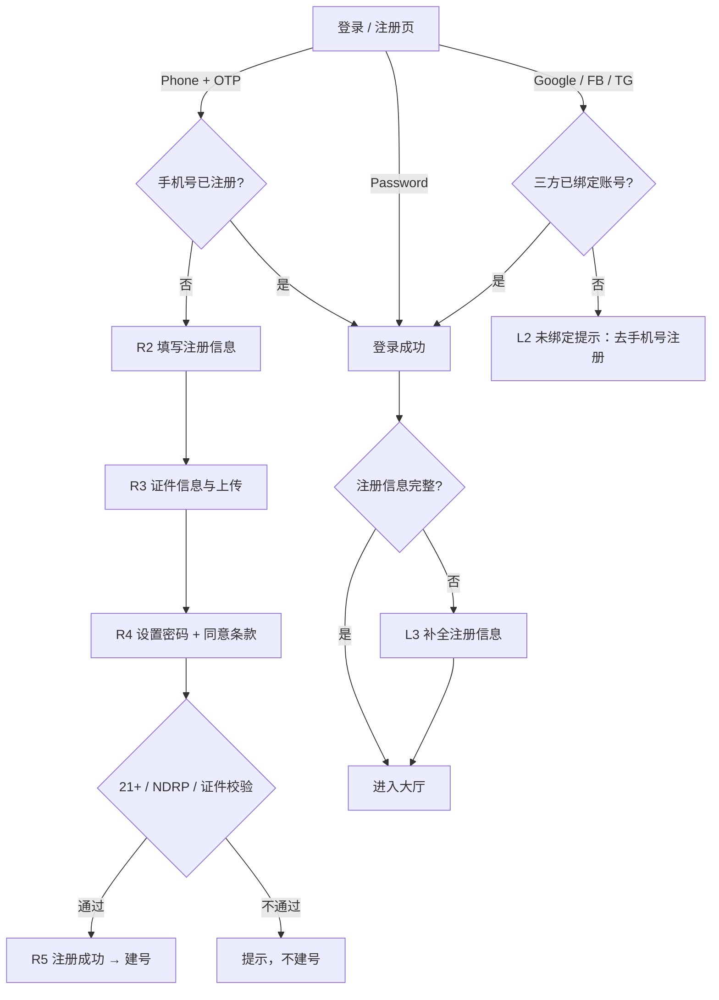

# 【789games】玩家注册与登录调整（合规）PRD v1.0

2026-11-27 · Koi

> 依据：合规条款「3. Player registration and login | 玩家注册与登录」（Koi 2026-11-27 提供的文件截图）。
> 参考范例：Home 页轮播弹窗 PRD v1.0（改造现网前台 + 后台的骨架：As-Is → 包含/不包含 → 状态表 → 旧数据迁移 → 风险表）。

## 资料

| 资料 | 链接 |
|---|---|
| 可交互原型 | https://koi980517.github.io/789games/registration-login/registration-login-prototype-v1.0.html |
| 条款原文 | 见本文 §1.1 |
| Wiki | PD › 2026-11 › 【789games】玩家注册与登录调整（待建） |
| Jira | 故事待建；子任务：后端 / 后台前端 / H5 / IOS/Flutter / Android |
| 参考 | `claude/第三方登录用户标识需求.md`（reg_method 枚举）；`claude/FB登录-修改验收-2026-11-06.md`；产品侧知识库第 1 章 账户与合规 |

---

## 1. 背景与范围

### 1.1 条款原文

> **3. Player registration and login | 玩家注册与登录**
> Players must register using their phone number and provide their full name, date of birth, nearest gaming venue, and government-issued ID during registration. Their phone number and other basic registration information must be visible in their account on the website.
> For subsequent logins, players may choose OTP, a password, Facebook, Google, or Telegram. Facebook, Google and Telegram are for login convenience only and not for registration purposes.
>
> 玩家必须使用手机号码注册，并在注册时提供全名、出生日期、距离自己最近的游戏场所及政府签发的身份证件。玩家的手机号码及其他基本注册信息必须在网站的玩家账户页面中显示。
> 后续登录时，玩家可选择使用一次性验证码（OTP）、密码、Facebook、Google 或 Telegram。Facebook、Google 和 Telegram 仅用于便捷登录，不可用于注册。

拆成 4 条要求：

| # | 要求 | 现网是否满足 |
|---|---|---|
| C1 | 只能用手机号注册 | ❌ Google / Facebook / Telegram（iOS 还有 Apple）授权后自动建号，账号可以没有手机号 |
| C2 | 注册时必须提供：全名、出生日期、最近的游戏场所、政府签发证件 | ❌ 注册只要手机号 + OTP；姓名、生日、证件在 KYC 时才收；「最近的游戏场所」现网没有这个字段 |
| C3 | 手机号和基本注册信息在网站账户页可见 | ⚠️ My Details 只有头像、昵称；手机号在 Account Security 里；姓名 / 生日 / 证件只在 KYC 记录里 |
| C4 | 后续登录可用 OTP / 密码 / FB / Google / TG，三方仅作便捷登录 | ⚠️ 登录方式都有，但三方同时承担注册；Apple、Viber（开发中）不在条款列表里 |

### 1.2 现状（As-Is）

> 来源：产品侧知识库 v2.1 第 1 章、2026-11-06 FB 登录验收记录。本次未重新登录 QA 后台和 H5 核对，标「待核」的项开发前需再读一遍现网。

| 落点 | 现状 |
|---|---|
| 登录 / 注册页 | 合在一个页面：手机号 + OTP（45s 重发）、账号 + 密码；下方 continue with Google / Facebook / Telegram（iOS 另有 Apple） |
| 三方登录 | 未绑定的三方账号授权后直接建号并登录（regMethod 2/3/5，FB 验收时新建 Player6708p8tep），昵称取三方名 |
| 注册风控 | 同 IP 同设备每天 1 个、同 IP 不同设备每天 10 个；人机验证 captchaType |
| 合规 | 21 岁 / 条款弹窗；NDRP 名单校验 |
| KYC | zoloz（Paddle 灰度），收姓名、生日、证件、自拍；GAM-2 继承老站 KYC |
| 账户页 | Account → My Details：头像、昵称、Check For Updates、Logout；Account Security：手机号（前 3 后 4）、密码、三方绑定状态（前台不能解绑，后台解绑） |
| 后台 | 用户列表 / 用户详情有手机号、注册时间、注册方式（user_detail.reg_method：1 手机号 / 2 Google / 3 Facebook / 4 Apple / 5 Telegram） |

问题：

| # | 问题 | 影响 |
|---|---|---|
| P1 | 三方授权直接建号 | 违反 C1，产生无手机号账号（提款、短信、风控都要特殊处理） |
| P2 | 注册不收身份信息 | 违反 C2；21 岁校验只靠弹窗勾选 |
| P3 | 「最近的游戏场所」无字段、无清单 | C2 无法满足 |
| P4 | 账户页看不到注册信息 | 违反 C3 |
| P5 | 存量三方注册账号、缺信息账号 | 上线后仍不合规，需要补全 |

### 1.3 包含 / 不包含

| 包含 | 不包含 |
|---|---|
| 注册流程改为：手机号 + OTP → 填注册信息（全名、生日、最近场所、证件）→ 设置密码 → 完成 | KYC 人脸比对流程本身（沿用 zoloz，见待确认 Q2） |
| 三方登录改为只登录：未绑定时不建号，引导手机号注册 | 新增登录方式（Viber 等） |
| 已登录后在 Account Security 绑定 Google / FB / TG | 三方前台解绑（沿用后台解绑） |
| 存量账号补全：缺手机号 / 缺注册信息的账号登录后强制补全 | 注销流程改动 |
| 账户页新增「Registration Info」只读展示 | 前台自助修改姓名 / 生日 / 证件（走客服） |
| 后台：用户详情注册信息、游戏场所清单配置、注册设置、补全统计 | 代理后台注册（另评估） |

### 1.4 目标

1. 上线后新注册账号 100% 有手机号 + 4 项注册信息。
2. 三方授权新建账号数 = 0。
3. 存量活跃账号（近 30 天登录）在补全期结束时注册信息完整率 ≥ 95%。
4. 账户页可直接看到手机号和全部基本注册信息。

### 1.5 适用范围

- 站点：**789games**。789games 与主站共用后端，改动按站点开关控制，主站（789bingo）不受影响（是否同步主站见 Q8）。
- 端：H5、PC、iOS（Flutter / 原生）、Android；三方登录只在主域名开放（沿用）。
- 币种 PHP；语言 English；时间 GMT+8。

---

## 2. 规则

| 项目 | 规则 |
|---|---|
| 注册方式 | 只能手机号 + OTP 注册。手机号 09 开头 11 位（沿用现网校验），一号一账号 |
| 注册必填 | 全名（First / Middle（可空）/ Last）、出生日期、最近的游戏场所、政府签发证件（类型 + 证件号 + 正面照片）、登录密码 |
| 年龄 | 按出生日期计算，满 21 周岁才能提交（GMT+8 当天计）；不足 21 岁提示并不能注册 |
| NDRP | 提交注册信息时用全名 + 生日校验 NDRP 名单（沿用现网名单与校验点），命中不建号 |
| 建号时点 | **全部信息提交成功后才建号**。OTP 验证通过只发「注册临时凭证」（regTicket，30 分钟有效），中途退出不建号；再次进入用同一手机号重新验证 OTP |
| 密码 | 注册时设置，8–16 位，须含字母和数字，不允许空格和表情（R5） |
| 登录方式 | OTP、密码、Google、Facebook、Telegram |
| 三方登录 | 只登录已绑定的账号；未绑定 → 不建号，弹窗引导手机号注册或用其他方式登录后到 Account Security 绑定 |
| 三方绑定 | 只能在登录状态下于 Account Security 绑定；一个三方账号只能绑一个平台账号；解绑沿用后台 |
| Apple / Viber | 条款未列出：Apple 隐藏，Viber 暂停上线（见 Q4） |
| 存量补全 | 缺手机号或缺注册信息的账号，任意方式登录后先进入补全页，补全前不能进入大厅（见 §3.4） |
| 信息修改 | 前台只读；姓名 / 生日 / 证件改动走客服，后台修改需权限 + 原因 + Google 验证码，写会员日志 |
| 注册风控 | 同 IP / 同设备限制、人机验证沿用现网；计数时点改为「建号成功」 |
| 站点开关 | 后台「注册设置」中按站点开关，**默认关闭**；开关即时生效、写操作日志 |

---

## 3. 前台流程

### 3.1 流程图

### 3.2 页面编号

| 编号 | 页面 | 触发条件 | 页面表现 |
|---|---|---|---|
| L1 | 登录 / 注册页 | 未登录进入 | 页签 OTP Login / Password Login；底部 continue with Google / Facebook / Telegram；标题 “Log in / Register”，说明 “New players register with mobile number only.” |
| R1 | OTP 验证 | L1 输入手机号点 Send Code | 人机 → 4 位短信码，45s 重发；已注册直接登录，未注册进 R2 |
| R2 | 基本信息（Step 1/3） | 新手机号 OTP 通过 | 手机号（已验证，不可改）、First / Middle / Last Name、Date of Birth、Nearest Gaming Venue（下拉，可搜索） |
| R3 | 证件（Step 2/3） | R2 Next | ID Type（下拉）、ID Number、上传证件正面照片 |
| R4 | 密码与确认（Step 3/3） | R3 Next | 设置密码、确认密码、勾选 21+ 与条款；信息预览；Submit |
| R5 | 注册成功 | 提交成功 | 建号，自动登录；按钮 Go to Lobby |
| L2 | 三方未绑定提示 | 三方授权成功但未绑定账号 | 弹窗，见 §3.3 |
| L3 | 补全注册信息 | 登录后账号缺手机号或注册信息 | 同 R2–R4 的表单（已有字段带出），无手机号的先绑手机号 + OTP |
| A1 | My Details · Registration Info | Account → My Details | 只读展示，见 §3.5 |
| A2 | Account Security · Linked Accounts | Account → Account Security | Google / Facebook / Telegram：未绑定显示 Link，已绑定显示 Connected + 账号 |

### 3.3 三方未绑定（L2）

- 授权回调后后端查不到绑定 → 返回 code `2801`（占位）+ 一次性 bindTicket（10 分钟），**不建号、不发会话**。
- 弹窗：
  - 标题：`No account linked`
  - 正文：`This {Google/Facebook/Telegram} account isn't linked to any 789games account. Please register with your mobile number first. You can link {Provider} in Account Security after logging in.`
  - 主按钮：`Register with Mobile Number` → 回 L1 OTP 页签
  - 次按钮：`I have an account` → 回 L1；用 OTP / 密码登录成功后，若 bindTicket 仍有效，弹出 `Link {Provider} to this account?`（Link / Not now），确认后绑定
- 取消授权：回到登录页，不提示（沿用）。

### 3.4 存量补全（L3）

| 账号类型 | 登录后表现 |
|---|---|
| 三方注册、无手机号 | 先「Bind Mobile Number」（手机号 + OTP，号码不能已被其他账号使用）→ 再补全注册信息 |
| 有手机号、缺注册信息 | 直接进补全表单；KYC 已通过的账号，姓名 / 生日 / 证件从 KYC 带出，只需补「最近的游戏场所」 |
| 信息完整 | 不出现 |

- 补全页顶部说明：`To comply with PAGCOR regulations, please complete your registration information.`
- 补全前：不能进入大厅、不能充值 / 提款 / 下注；右上角可 Logout。
- 弹窗队列：补全页是**全屏页**，排在 21 岁 / 条款弹窗之后、其他所有营销弹窗之前；补全完成后才开始弹窗队列。
- 过渡期（Q5）：可配置「补全宽限期」天数，宽限期内显示可跳过的提醒（Later），到期后强制；默认 0（直接强制）。

### 3.5 账户页展示（A1）

My Details 新增卡片「Registration Info」（只读）：

| 字段 | 显示 |
|---|---|
| Mobile Number | `0917 *** 4567`（前 4 后 4，Q6 确认是否需全显） |
| Full Name | `Juan D. Dela Cruz` |
| Date of Birth | `15 Mar 1995` |
| Nearest Gaming Venue | 场所名 + 城市 |
| Government ID | 类型 + 证件号后 4 位，如 `UMID · ****1234` |
| Registered On | `2026-11-27 14:05 (GMT+8)` |
| Registration Method | `Mobile Number` |

卡片底部：`To update your information, please contact Customer Service.`（链接到客服）

### 3.6 校验与文案（英文原文）

| 场景 | 文案 |
|---|---|
| 必填为空 | `This field is required` |
| 姓名格式 | `Letters, spaces, hyphens and periods only (max 50 characters)` |
| 未满 21 | `You must be at least 21 years old to register.` |
| 证件号重复 | `This ID is already registered. Please contact Customer Service.` |
| 证件照片 | `Please upload a clear photo of your ID (JPG/PNG, max 5 MB).` |
| NDRP 命中 | `We're unable to complete your registration. Please contact Customer Service.` |
| regTicket 过期 | `Session expired. Please verify your mobile number again.` |
| 三方已绑他人 | `This {Provider} account is already linked to another 789games account.` |

### 3.7 埋点（复用 firebase-tracking-spec）

- `sign_up` 参数 `method` 固定 `phone_otp`；新增 `reg_step_view`（step=1/2/3）、`reg_submit_fail`（reason）、`third_party_unlinked`（provider）、`profile_complete`（source=new/legacy）。
- 不上报姓名、生日、证件号、场所等 PII。上报通道见 Q9。

---

## 4. 字段规则

| 字段 | 必填 | 规则 |
|---|---|---|
| firstName / lastName | 是 | 1–50 位，字母、空格、`-`、`.`、`'`；前后空格去除；存储原样大小写 |
| middleName | 否 | 同上 |
| birthDate | 是 | 日期选择器，格式 DD/MM/YYYY；不能晚于今天；满 21 周岁 |
| venueId | 是 | 从后台「游戏场所清单」中选择，只显示启用的；支持按名称 / 城市搜索 |
| idType | 是 | 下拉，清单后台可配置，默认：PhilSys National ID、Passport、Driver's License、UMID、SSS ID、PRC ID、Postal ID、Voter's ID、PhilHealth ID |
| idNumber | 是 | 按类型校验长度（后端字典）；同站点内同 idType + idNumber 唯一 |
| idPhoto | 是 | jpg / png / webp，校验真实类型，≤5 MB（压缩后），存私有桶，访问鉴权 |
| password | 是 | 8–16 位，字母 + 数字 |

- 与 KYC 的关系：注册证件信息写入独立的 `user_reg_profile`；KYC 提交时姓名 / 生日 / 证件默认带出注册信息（Q2）。

---

## 5. 后台配置

### 5.1 用户管理 → 用户详情

- 新增「注册信息」分组：手机号、全名、生日、最近场所、证件类型、证件号（默认脱敏，点「查看」需权限并写日志）、证件照片（点击查看，需权限）、注册时间、注册方式、信息完整状态（完整 / 待补全）、补全时间。
- 「编辑注册信息」按钮：需权限 + 修改原因 + Google 验证码；写会员日志（旧值 → 新值）。
- 用户列表：新增筛选「信息完整状态」「最近场所」；新增列「信息完整」。

### 5.2 系统设置 → 注册设置（新增）

| 分组 | 字段 | 规则 |
|---|---|---|
| 开关 | 合规注册流程（按站点） | 默认关；开启后注册走 R1–R5、三方停止建号 |
| 开关 | 存量账号强制补全 | 默认关；可单独开 |
| 补全 | 宽限期（天） | 0–30，默认 0 |
| 证件 | 证件类型清单 | 名称、证件号长度规则、启用、排序 |
| 证件 | 证件照片大小上限 | 默认 5 MB |

保存需 Google 验证码，写操作日志。

### 5.3 系统设置 → 游戏场所清单（新增）

- 列表：场所名称、城市 / 省、地址、启用状态、排序、更新时间、操作（编辑 / 停用）。
- 新增 / 编辑：名称（必填，英文）、城市（必填）、地址、排序。支持 CSV 批量导入（首行 name,city,address）。
- 停用不删除：已选该场所的用户照常显示（标「已停用」），新注册不可选。
- 清单内容由合规 / 运营提供（Q3）。

### 5.4 数据

- 注册统计、代理留存报表注册方式筛选：上线后新注册 regMethod 恒为 1；存量三方注册用户保留原 regMethod。
- 新增「注册信息补全统计」：存量待补全数、已补全数、按日补全数、按注册方式拆分。

### 5.5 权限码（cate=3，号段开发确认）

| 权限码 | 名称 |
|---|---|
| reg_setting_view / reg_setting_edit | 注册设置 查看 / 编辑 |
| venue_view / venue_edit | 游戏场所清单 查看 / 编辑 |
| user_reg_profile_view_sensitive | 查看证件号全号与证件照片 |
| user_reg_profile_edit | 编辑注册信息 |

---

## 6. 接口（草案）

| 方法 | 路径 | 说明 |
|---|---|---|
| POST | /api/v2/auth/otp/send | 沿用，返回 `registered: true/false` |
| POST | /api/v2/auth/otp/verify | 已注册 → 登录；未注册 → 返回 regTicket，不建号 |
| GET | /api/reg/options | 证件类型、场所清单（启用） |
| POST | /api/reg/id-photo | 上传证件照片（凭 regTicket 或登录态），返回 fileId |
| POST | /api/reg/submit | regTicket + 全部字段 + requestId；服务端重校验 21+ / NDRP / 证件唯一 → 建号 → 返回会话 |
| POST | /api/v2/auth/{google,facebook,telegram} | 已绑定 → 登录；未绑定 → 2801 + bindTicket |
| POST | /api/user/bind/{provider} | 登录态绑定（或携带 bindTicket） |
| POST | /api/user/profile/complete | 存量补全 |
| GET | /api/user/reg-profile | A1 展示，证件号服务端脱敏 |

- submit 处理顺序：校验 regTicket → 加锁（手机号）→ 字段校验 → 21+ / NDRP → 证件唯一 → 建号（写 user + user_reg_profile，reg_method=1）→ 释放 regTicket → 发会话。requestId 幂等，重复提交返回同一结果。
- 证件号、照片地址不进 URL、日志；接口不收 userId，从 JWT 取。

---

## 7. 验收要点

1. 新手机号：OTP → R2 → R3 → R4 → 建号，后台注册方式 = 手机号，注册信息完整。
2. R2/R3 中途退出：不产生账号；30 分钟内重新验证 OTP 可继续，超时提示重新验证。
3. 生日边界：今天正好满 21 周岁（GMT+8，00:00 跨天）可注册；差 1 天不可。
4. NDRP 命中、证件号重复：不建号，文案正确。
5. 未绑定的 Google / FB / TG 授权：不建号（后台用户数不变），弹 L2；走 I have an account 登录后可绑定。
6. 已绑定的三方账号：直接登录。
7. 三方注册的无手机号存量账号：登录后先绑手机号再补全，补全前无法进入大厅 / 充提 / 下注。
8. KYC 已通过的存量账号：只需补场所。
9. A1 展示与后台一致；证件号只显示后 4 位。
10. 开关关闭：流程与现网一致；开启即时生效。
11. 重复点击 Submit、并发同手机号提交：只建 1 个号。
12. 多端：H5 / PC / iOS / Android 逐端；iOS 不再显示 Apple。

---

## 8. 待确认

1. **Q1 证件照片**：注册时是否必须上传照片，还是只填证件类型 + 号码？（当前默认：必须上传正面照片）— 合规
2. **Q2 与 KYC 的关系**：注册证件能否直接算作 KYC 证件、KYC 只补人脸？还是保持 KYC 独立？（当前默认：KYC 独立，带出注册信息）— 合规 / 风控
3. **Q3 游戏场所清单**：清单来源与范围（PAGCOR 持牌场所？自家门店？）由谁维护。— 合规 / 运营
4. **Q4 Apple / Viber**：条款只列 FB / Google / TG。Apple 隐藏是否会触发 App Store 4.8 审核问题；Viber（-6517）是否暂停。— 合规 / iOS
5. **Q5 存量补全**：是否需要宽限期、强制范围（全部存量 / 仅活跃）。（当前默认：开关开启即全部强制）— 运营 / 合规
6. **Q6 手机号显示**：条款要求「可见」，是否允许前 4 后 4 脱敏？— 合规
7. **Q7 证件唯一**：同一证件能否注册多个账号（一人多证需求曾被否决）。（当前默认：同站点唯一）— 风控
8. **Q8 站点**：主站 789bingo 是否同步执行。（当前默认：只 789games）
9. **Q9 埋点通道**：平台无服务端埋点通道，前端上报是否足够。
10. **Q10 代理注册链接 / 邀请码**：走新流程时归属参数在 regTicket 中保留（默认如此），需后端确认。

## 9. 风险与依赖

| 等级 | 类别 | 风险 | 应对 |
|---|---|---|---|
| 高 | 合规 | 存量无手机号账号未补全仍可交易 | 强制补全拦截充提下注；后端接口按「信息完整」校验，不只靠前端 |
| 高 | 安全 | 证件号、证件照片泄露 | 私有存储、鉴权访问、脱敏展示、查看全号写日志；不进 URL / 日志 |
| 中 | 稳定性 | 注册步骤变长，转化下降 | 埋点漏斗监控；三步进度条；场所可搜索 |
| 中 | 多端一致性 | App 老包仍走三方建号接口 | 后端统一拦截（老包收到 2801 显示通用错误「请更新到最新版本」）；评估强更 |
| 中 | 资金 | 补全时绑定的手机号已被其他账号占用 | 提示联系客服，人工合并 / 处理 |
| 低 | 合规 | iOS 去掉 Apple 登录 | 审核前与 iOS 确认（Q4） |

依赖：NDRP 名单接口（-6387）、KYC 带出（-6448/-6450 的 KYC 提交信息配置）、三方绑定接口（现网 Account Security）、App 强更策略、统一弹窗队列。

## 10. 变更记录

| 日期 | 变更 |
|---|---|
| 2026-11-27 | v1.0 初稿：按合规条款第 3 条整理注册 / 登录调整，含原型 v1.0 |
